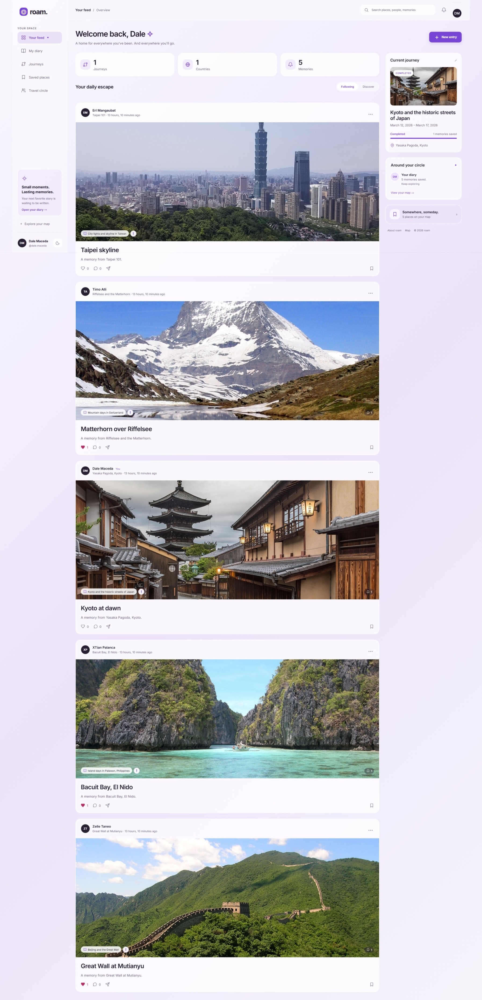
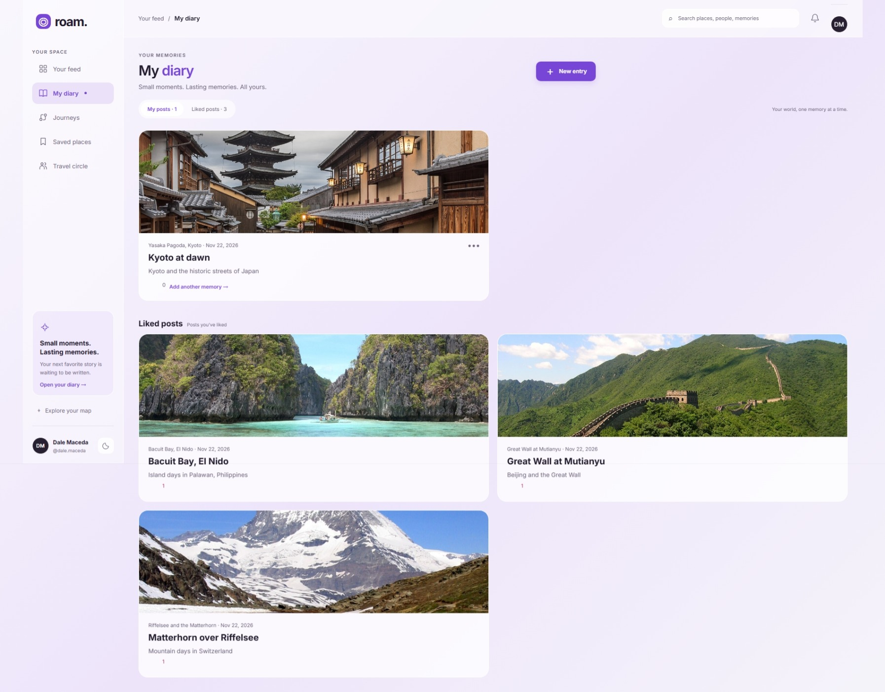
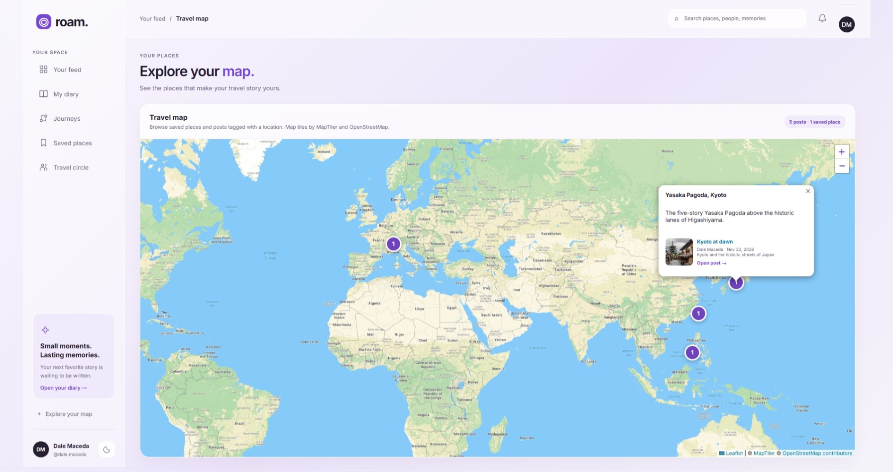
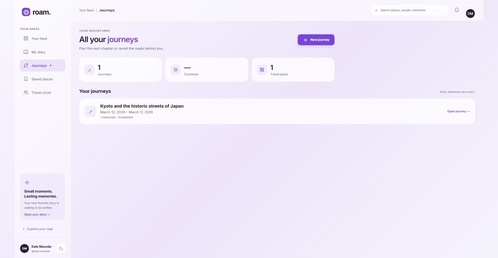
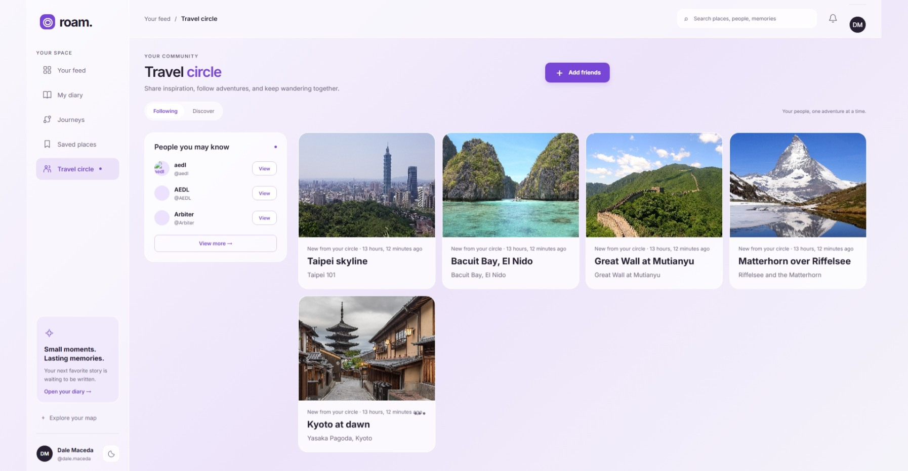

# TravelDiary

TravelDiary is a Django travel journal for saving memories, planning journeys, discovering places, and sharing experiences with friends.

## Screenshots

### Landing Page

### Your Feed

### My Diary

### Explore Map

### Journeys

### Travel Circle

## Features

- Create and organize travel memories with photos and journal entries
- Plan journeys with countries, dates, itineraries, stays, and expenses
- Save places and explore them on an interactive map
- Follow friends, share posts, and view notifications
- Manage your profile, avatar, cover image, and travel details
- Sign up, log in.

## Built With

- Python and Django
- Django REST Framework
- SQLite
- HTML, CSS, and JavaScript
- Leaflet/OpenStreetMap map services

## Run the Project

## About the Author

**Name:** ΛΞDL

* 

## Members (Collective in Names Only)

- **Jezelle**  
  

- **Timo**  
  

- **xTian**  
  

- **Erl**  
  
